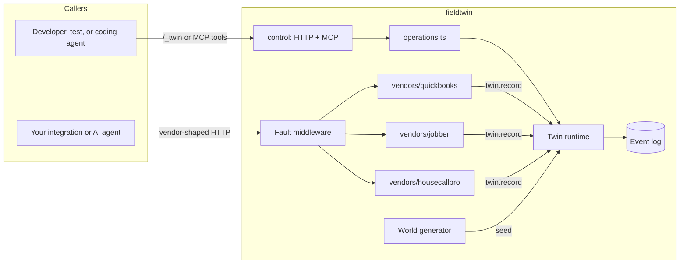

# Architecture

This document explains how fieldtwin is put together and, more importantly, the few rules that keep it easy to maintain. If a change would break one of these rules, open an issue to discuss it first.

## Goals

- **Believable.** Code that works against the twin should work against the real API, and code that breaks on the real API should break on the twin.
- **Reproducible.** Same seed and same requests give a byte-identical event log.
- **Inspectable.** At any moment you can see exactly what changed and why.
- **Easy to extend.** Adding a vendor or an endpoint should mean copying an existing pattern, not learning a framework.

## Non-goals

- Full parity with any vendor. We model the behavior integrations actually depend on and say clearly what we skip (FIDELITY.md).
- Cloning vendor UIs.
- Syncing vendors with each other. That is the job of the code under test.
- Production use. This is a test environment.

## The picture



## The three rules

**1. All state changes go through `twin.record()`.** A route never edits state directly. It works out the new record, then records an event (`CustomerCreated`, `CustomerUpdated`) and the vendor's `apply()` function updates state. This single write path is what makes "what did my agent change?" and "rewind" possible, and it means there is exactly one place to look when state is wrong.

The rule covers *business state*: anything the fake company would see in its own books or schedule. Request bookkeeping is different. Spending a rate-limit budget changes nothing about the business, so it lives outside the log (`core/bookkeeping.ts`, behind `twin.rateLimit()`), and `reset()` and `rewind()` clear it rather than replay it. OAuth grants and webhook subscriptions are your app's settings, so they live outside the log too and survive both; webhook deliveries are bookkeeping about requests, and a reset or rewind drops the ones still pending. Keep that exception small: if a client could ever read it back as data, it belongs in the log.

**2. Time comes from `twin.clock`; randomness comes from `SeededRandom`.** `Date.now()` and `Math.random()` do not appear in this codebase. This is what makes runs reproducible and lets tests skip ahead in time instantly. Faults roll their own random streams (one for requests, one for webhook deliveries; `core/streams.ts` lists every stream), so turning a fault on never changes the generated world, and subscribing to webhooks never changes which requests fail. A checkpoint remembers where those streams were, so after a rewind the same requests meet the same faults.

**3. Vendor state can always be rebuilt from the event log.** `apply()` must be deterministic: the same events in always produce the same state out. Events carry complete records (the whole customer, not "change field X") so `apply()` stays trivially simple.

## Layers and who may import whom

```text
world/        imports nothing from the project except core/random
core/         imports world/ only
vendors/x/    imports core/ and world/ only. Never another vendor.
faults/       imports core/ only. Never a specific vendor.
control/      imports core/ only; HTTP and MCP adapters both go through operations.ts
app.ts        the only file that knows every piece exists
server.ts     entry point for `npm start`: imports app.ts and control/, and nothing imports it
mcp.ts        entry point for `npm run mcp`, the same plus MCP over stdio
examples/     imports nothing from src/: it reaches the twin over HTTP, like any client
conformance/  the same
dashboard/    the same, as a package of its own that uses only /_twin
```

The `.test.ts` files in `examples/`, `conformance/`, and `dashboard/` may import `src/`, to run a twin in process.

If two vendors need the same helper, it moves to `core/`. If you find yourself importing a vendor from `faults/` or `control/`, the vendor contract is missing something; add it to `VendorTwin` instead.

These rules are enforced, not just written down: `test/import-boundaries.test.ts` parses every import in `src/` (and in `examples/`, `conformance/`, and `dashboard/`) and fails with the offending `file imports file`, and `test/determinism.test.ts` does the same for rule 2.

## Anatomy of a vendor folder

Every vendor has the same files, so once you have read one you can read them all.

| File | Holds |
|---|---|
| `types.ts` | Record shapes, named exactly as the vendor's docs name them. Housecall Pro's has grown into `types/`: its people and its work |
| `events.ts` | The event payloads this vendor records, and `describeEvent()`: one plain-language line per event |
| `state.ts` | `createState()` and `apply()`, the only code that changes this vendor's state |
| `seed.ts` | Turns the shared world into this vendor's starting events |
| `routes.ts` | HTTP routes shaped like the real API. Validates, decides, then calls `twin.record()`. QuickBooks and Housecall Pro have grown this into `routes/`, one file per entity |
| `errors.ts` | Error bodies in the vendor's real format (REST vendors) |
| `oauth.ts` | The vendor's OAuth 2.0 server: its paths, how long codes and tokens last, and how refresh works (`core/oauth.ts` does the rest) |
| `webhooks.ts` | Optional. The webhooks the vendor sends: its topics, which events announce what, how a delivery is shaped and signed, and how long an app has to answer before it is tried again (`core/webhook-dispatcher.ts` queues and sends them) |
| `index.ts` | Exports one `VendorTwin` object. Nothing else |

GraphQL vendors also have `schema.graphql` (a hand-written subset of the public schema), `resolvers.ts` (plain functions of state), and anything vendor-specific like Jobber's `cost.ts`. Jobber has grown both into folders: `schema/` holds one `.graphql` file per area (each `extend type Query` with its own lists), and `resolvers/` one file per object, plus `statuses.ts`, which derives time-dependent statuses from facts and the twin clock instead of storing them, and `lookups.ts`, which gathers which records belong to each client, job, and quote once per change, so a page of results never reads the whole business once per node.

## What happens on a request

Take `POST /v3/company/{realm}/customer` with a stale SyncToken.

1. `app.ts` routed `/v3/*` through the QuickBooks fault middleware. No fault rule matches, so it passes the request on.
2. `quickbooks/routes/index.ts` checks the bearer token and realm. `quickbooks/routes/customer.ts` sees an `Id` in the body and calls `updateCustomer()`.
3. `updateCustomer()` asks `checkSyncToken()` (shared by every QuickBooks entity, in `routes/entity.ts`), finds a mismatch, and returns `qboErrors.staleObject()`. Nothing is recorded, so state and the log are untouched.

With a correct SyncToken, step 3 instead builds the full updated record, calls `twin.record({ type: "CustomerUpdated", ... }, "api")`, and returns it. The event's `source: "api"` is how `/_twin/.../changes?source=api` later separates your code's changes from seed data and scenario events.

## Key decisions

**An event log instead of a database.** Tradeoff: rebuilding state means replaying events, which is slower than a database for huge worlds. In return we get rewind, change lists, reproducible bug reports (attach `log.jsonl`), and state that is plain objects anyone can read. Twin worlds are small, so replay is fast. If that ever stops being true, add periodic snapshots inside `Twin`; no vendor code changes.

**Hand-written schema subsets instead of importing vendor specs.** A generated client of a 500-type schema is unreadable and mostly unused. We add fields as tests need them, each one traceable to the public docs.

**Vendors don't sync with each other.** Both are seeded from one world, so they start out consistent, but after that they drift exactly like real systems. A scenario can even seed deliberate mismatches (the same customer spelled two ways) to test sync logic.

**Faults are data.** Fault rules are plain objects in YAML. The middleware asks the vendor for an error body in its own format, so vendors never contain fault logic and every vendor gets every fault type for free.

**One operations module.** HTTP control routes, MCP tools, and tests all call `control/operations.ts`, so each operation has one implementation and the adapters stay a few lines long.

**Small, boring dependencies.** Hono (HTTP), graphql-js (the reference GraphQL implementation), zod (validating scenario files), yaml, and the official MCP SDK. No ORM, no dependency injection framework, no code generation.

## Scenario timelines

A scenario can schedule things to happen as twin time passes:

```yaml
timeline:
  - at: "08:00"          # business time on the start date; also "+90m", "+2h", "+1d", or a time with a UTC offset
    jobber: { newClients: 15 }
  - at: "+4h"
    jobber: { payInvoices: 3 }
```

The design is deliberately small:

- **Vendors own their actions.** Each vendor may export `scenarioActions` on its `VendorTwin`: named actions that check their parameters when the scenario loads and return complete events when they run. `control/` only resolves times and hands the twin a flat list of `{ atMs, vendor, action, params }`; it never learns what an action does.
- **The clock drives the schedule.** `twin.advance(ms)` (behind `POST /_twin/clock/advance` and the MCP tool) stops at each due entry, sets the clock to the entry's time, and records its events with source `scenario`. Nothing runs on wall-clock time. Code that calls `twin.clock.advance()` directly skips the schedule; use `twin.advance()`.
- **History stays honest.** Entries at or before the load time run at load. Rewinding to a checkpoint makes every later entry due again; the earlier ones are already in the kept history, so nothing is applied twice. Each entry draws from its own seeded random stream, so a re-armed entry creates the same new clients as before.
- **Bad scenarios fail at load, and change nothing.** An unknown key, vendor, action, time format, or parameter is an error when the YAML is loaded, not hours of twin time later, and a scenario that fails to load leaves the twin as it was. Times need a UTC offset (`Z` or `-05:00`), so a scenario means the same moments on every machine.

## Code style

The goal is code a new contributor can read top to bottom without jumping around.

- Plain functions and plain objects. A class only when it owns changing state (`Twin`, `TwinClock`, `LeakyBucket`).
- Name things the way the vendor's docs name them (`SyncToken`, `DisplayName`, `clients`, `pageInfo`), so code can be checked against the docs line by line.
- A file does one job and stays under about 200 lines. When it grows, split it by job, not by type. When a file from the vendor anatomy outgrows that, it becomes a folder with the same name (`routes.ts` becomes `routes/index.ts` plus one file per entity), so every vendor's top level still reads the same.
- Every vendor behavior gets a comment saying what the real API does and why it matters, with a docs link when there is one. Comments explain *why*; the code already says *what*.
- No clever tricks: no metaprogramming, no decorators, no inheritance between vendors.
- Error messages say what was wrong and what to do about it.
- Every behavior has a test, named as a sentence about the behavior.

## Adding a vendor

1. Add the name to `VENDOR_NAMES` in `core/types.ts`. Scenarios, fault rules, and webhook subscriptions accept exactly those names.
2. Copy `vendors/quickbooks/` (REST) or `vendors/jobber/` (GraphQL) to `vendors/<name>/` and empty it out.
3. Write `types.ts` from the vendor's public docs, then `state.ts`, `seed.ts`, `routes.ts`, `index.ts`, in that order.
4. Pick a `pathPrefix` no other vendor uses.
5. Add it to `ALL_VENDORS` in `app.ts`.
6. Add `test/<name>.test.ts` and a section in FIDELITY.md.

## Roadmap

- **Shipped.** v0.1 to v0.4, from the first twins to the dashboard: see [CHANGELOG.md](CHANGELOG.md).
- **Next.** More Jobber writes (`jobCreate` and visit scheduling) as their inputs reach the public docs, and the first conformance recordings from real sandboxes.
- **v0.5.** More vendors: Housecall Pro (begun; the changelog's Unreleased section says how far), Samsara or Motive, and an EDI trading-partner twin for load tenders (204), responses (990), and status messages (214).
- **v0.6.** A benchmark for dispatch and operations agents, built on these twins.
